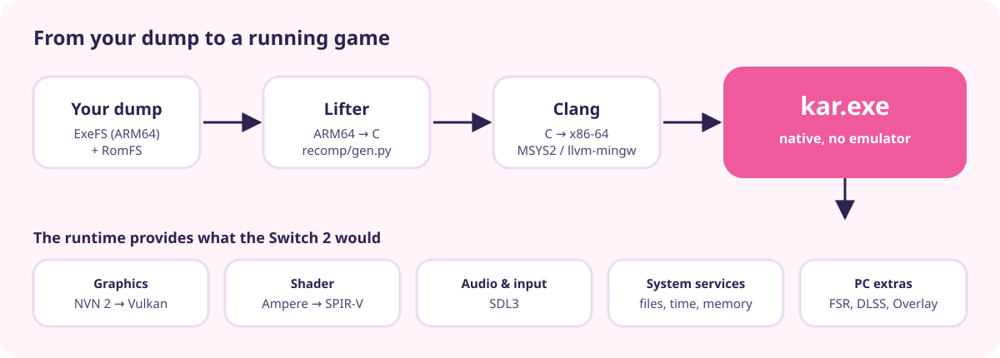

<p align="center">
  
</p>

<p align="center">
  
  
  
  
</p>

<p align="center">
  <b>A native Windows port of <i>Kirby Air Riders</i> (Switch 2, update 1.3.3).</b><br>
  The game's ARM64 code is translated to C ahead of time and built into a normal <code>kar.exe</code>.<br>
  No emulator, no JIT: graphics, audio, input and system services come from its own runtime.
</p>

---

> [!IMPORTANT]
> **This repository contains no game data.** Game code, the lifted C code, the RomFS, shader caches, screenshots and
> build output stay on your machine. You need your own dump of the game. `.gitignore` and
> `tools/check_content.py` (pre-commit hook and CI) keep such files out of the repository.

## Highlights

<table>
<tr>
<td width="33%" valign="top">

### 🏁 The whole game
Air Ride, Top Ride, City Trial and Road Trip, menus, movies and saves. A 75-minute soak runs without a crash.

</td>
<td width="33%" valign="top">

### 🖥️ Built for PC
Any resolution, ultrawide 21:9 and 32:9 with the HUD kept 16:9, frame-rate limit up to 240 or unlimited, monitor
choice, an in-game overlay (F1) for every setting.

</td>
<td width="33%" valign="top">

### ✨ Upscaling and frame generation
AMD FSR 1 and FSR 3.1, NVIDIA DLSS (separate add-on) and frame generation with AMD FSR 3 or NVIDIA DLSS:
about twice the frames shown.

</td>
</tr>
<tr>
<td valign="top">

### 🎮 Controllers and keyboard
Xbox, PlayStation and Switch Pro pads with rumble and gyro, full keyboard and mouse, keyboard as player 2, button
symbols in the game's own text that follow your pad and your bindings.

</td>
<td valign="top">

### ⚡ Fast start
Shaders and pipelines are built ahead in the background; with a warm cache the game is up in about a second.

</td>
<td valign="top">

### 📦 Installer
Builds everything from your dump: checks it, packs the data, lifts the code and compiles it, with MSYS2 or the
llvm-mingw toolchain.

</td>
</tr>
</table>

## How it works

<p align="center">
  
</p>

- **Lifter** (`recomp/`): reads the game's executables and turns every function into C, with a patch table for the few
  places the PC needs to differ.
- **Runtime** (`runtime/`): NVN 2 graphics on Vulkan, the Switch 2's Ampere shaders lowered and translated to SPIR-V,
  audio and input over SDL3, files, threads, time and the other system services the game calls.
- **PC extras**: upscalers, frame generation, ultrawide, the settings overlay and button symbols.

The project builds on *DKB Recomp* (Donkey Kong Bananza), which itself grew out of *TotK Recomp*. The original
README of that base is in [`docs/README-dkb-upstream.md`](docs/README-dkb-upstream.md).

## Status

| Area | State |
|---|---|
| Boot, title, movies, menus, all modes | ✅ works |
| Races at 60 fps, up to 140+ with a higher limit | ✅ works |
| Audio, saves | ✅ works |
| Local split screen (pad + keyboard, two pads) | 🧪 being tested |
| FSR 1, FSR 3.1, DLSS (add-on) | ✅ works, Vulkan validation clean |
| Frame generation: AMD FSR 3, NVIDIA DLSS | ✅ works (DLSS: RTX 40/50) |
| Ultrawide 21:9 / 32:9 | ✅ works |
| Installer from your own dump | ✅ command line; the window is being tested |
| AMD and Intel GPUs, Windows 10, Linux | ❔ not tested yet |
| HDR | ⏸ waiting for an HDR display to test on |

## Getting started

### Requirements

- Windows 10 or 11, a GPU with Vulkan 1.3 (tested on NVIDIA so far)
- About 55 GB of free space while installing
- Your own `.nup` dump of *Kirby Air Riders* with update 1.3.3 (no keys needed)

### With the installer

```bat
.venv\Scripts\python -m installer
```

It asks for your dump and a target folder, then checks, packs, lifts and compiles, and leaves a ready `kar.exe`.
Details: [`docs/installer.md`](docs/installer.md).

<details>
<summary><b>By hand, step by step</b></summary>

Needs MSYS2 UCRT64 Clang (`C:\msys64\ucrt64\bin` on `PATH`), the .NET 10 SDK for the shader translator and the two
Python environments `.venv` and `.venv-py314` (see [`docs/building.md`](docs/building.md)).

```bat
:: 1. Unpack the game code (ExeFS) of the newest update
.venv-py314\Scripts\python tools\extract_nup.py <your>.nup --select latest --only exefs --out build\extracted\kar458752

:: 2. Pack the game data (RomFS, ~20 GB) into one file
.venv-py314\Scripts\python tools\extract_nup.py <your>.nup --select latest --only romfs --pack --out build\extracted\kar458752-packed

:: 3. Build the shader translator once
.venv\Scripts\python tools\build_xlate.py

:: 4. Lift the game code to C (with Kirby's patch table and the EffectScript module)
.venv\Scripts\python recomp\gen.py --exefs build\extracted\kar458752\exefs --out generated\kar458752 ^
    --modules main,subsdk0,subsdk1,sdk ^
    --nro effectscript=build\extracted\kar458752\romfs\Bin\Module\EffectScript.nro ^
    --patches recomp\patches-kar458752.txt

:: 5. Build
.venv\Scripts\python tools\build_game.py --version kar458752 --expected tools\data\expected-kar458752.json --romfs build\extracted\kar458752-packed\romfs
```

The result is `build\kar458752\kar.exe`. The first start translates and compiles the shaders; later starts are
fast. Always quit by closing the window rather than killing the process, so the pipeline cache is kept.

</details>

### Optional: NVIDIA DLSS

DLSS is not part of this repository. It is a separate add-on, `kar_upscaler.dll`, kept outside it and built by
each user: its build script fetches the DLSS SDK and NVIDIA Streamline from NVIDIA's own repositories, and you accept NVIDIA's licence
when you build it. The game talks to it only through a small, neutral interface (`runtime/ext_upscaler.h`, also MIT).
Once the add-on sits next to `kar.exe`, *NVIDIA DLSS* appears in the overlay for upscaling and frame generation.

## Controls and settings

Press **F1** in the game for the settings overlay (display, graphics, controls, audio). Every setting is also a line
in `totk.ini` next to the exe. Keyboard and pad defaults, remapping and the button symbols:
[`docs/controls.md`](docs/controls.md). All switches for testing and diagnosis:
[`docs/kirby-running.md`](docs/kirby-running.md).

## Repository layout

| Path | What is in it |
|---|---|
| `recomp/` | Lifter, generator, patch tables |
| `runtime/` | The runtime (C/C++): graphics, shaders, audio, input, system services, PC extras |
| `tools/` | Build, packaging, tests, Kirby tools (`kar_*`) |
| `installer/` | The installer (command line and window) |
| `docs/` | Documentation |
| `kirby/` | Task list, work log, input scripts for automated runs |
| `build/`, `generated/`, `refs/` | **local only**, never checked in |

## Legal

This repository contains only original code and code of its base, under the licences listed in
[`THIRD_PARTY_NOTICES.md`](THIRD_PARTY_NOTICES.md); as a whole it is GPL-3.0-or-later. *Kirby Air Riders* is a
trademark of Nintendo / HAL Laboratory. This is an unofficial fan project, not affiliated with or endorsed by
Nintendo or HAL Laboratory. You need a legally obtained copy of the game to use it.
